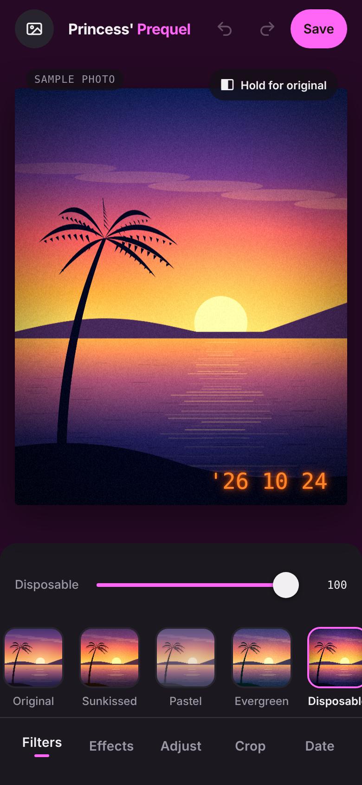

# Princess' Prequel

A mobile photo editor that runs in the browser, inspired by aesthetic editing apps like Prequel. Pick a photo, apply film looks and retro effects, fine-tune everything with sliders, and save the result to your camera roll.

It's a single HTML file with no frameworks, no build step and no server. All editing happens on your device, so photos are never uploaded anywhere.

<p align="center">
  
</p>

## Features

**Filters:** 14 looks, each with a strength slider:
Original, Sunkissed, Pastel, Evergreen, Disposable, Camcorder, Haze, Y2K, Cinema, Noir, Lomo, Faded, Instant and Glitch.

**Effects:** stackable, each with its own sliders:

| Effect | What it does |
|---|---|
| Grain | Film grain with adjustable amount and size |
| VHS | Tape wobble, color smear, scanlines and static |
| Glitch | Displaced horizontal strips |
| Prism | RGB channel split with adjustable angle |
| Light leak | Warm film-edge glow |
| Dust | Specks and scratches |
| Glow | Soft bloom on bright areas |
| Vignette | Darkened edges |

VHS, Glitch, Light leak and Dust have a **Shuffle** button that generates a new random pattern.

**Adjust:** exposure, contrast, highlights, shadows, saturation, warmth, tint, fade and sharpen.

**Crop:** Original, Square, 4:5, 3:4, Story (9:16) and Wide (16:9). Drag the photo to frame it, and use rotate and flip.

**Date stamp:** a retro camera date in orange, red or cream, with editable text.

**Also:**
- Hold the photo, or the *Hold for original* button, to compare with the unedited image.
- Undo and redo.
- Double-tap a slider's label to reset it.
- Saves a full-resolution JPG.

## Using it on iPhone

1. Open the site in **Safari**.
2. Tap **Share**, then **Add to Home Screen**, then **Add**.
3. Open it from the home-screen icon. It runs full-screen like a native app.

**To edit a photo:** tap the photo icon at the top left, choose a picture, and edit it.

**To save:** tap **Save**, press and hold the finished photo, and tap **Save to Photos**. You can also tap **Save file** to use the share sheet.

It also works in any modern mobile or desktop browser that supports WebGL.

## Running it locally

There's nothing to install. Open `index.html` in a browser.

If your browser blocks some features for local files, serve the folder instead:

```bash
python3 -m http.server 8000
# then visit http://localhost:8000
```

## Deploying

This is a static site, so any static host works:

- **Netlify:** drag the project folder onto [app.netlify.com/drop](https://app.netlify.com/drop), or connect this repository so every commit deploys automatically.
- **GitHub Pages:** go to **Settings → Pages**, set the source to the `main` branch and the `/ (root)` folder, and save. The site appears at `https://<username>.github.io/<repo>/`.
- **Cloudflare Pages / Vercel:** import the repository with no build command and an output directory of `/`.

## How it works

| Layer | Technology |
|---|---|
| Structure | HTML |
| Styling | CSS: custom properties, Flexbox and Grid, and `env(safe-area-inset-*)` for the notch and home indicator |
| Logic | Vanilla JavaScript: state, undo/redo history, and UI building |
| Rendering | **WebGL** with a single **GLSL** fragment shader that applies every filter, effect and adjustment on the GPU |
| Overlay and export | Canvas 2D for the date stamp, thumbnails and JPG encoding |
| Fonts | Google Fonts: Bricolage Grotesque, DM Mono and VT323 |
| Icons | Inline SVG |

Some details:

- **One shader pass.** Every pixel runs through UV distortion (VHS and glitch), RGB split, blur sampling (glow and sharpen), the adjustments, the color grade, overlays (light leak, scanlines and dust), vignette and grain. That keeps the sliders smooth on a phone.
- **Seeded randomness.** Grain, glitch, dust and leaks use hash functions with stored seeds, so a pattern stays the same while you edit and matches in the saved image.
- **Preview vs. export.** The preview renders at screen resolution, capped at 1600 px. Saving re-renders the same settings at the photo's full resolution, up to 4096 px on the long edge because of GPU texture limits.
- **Edit state.** All edits live in one plain JavaScript object. Undo and redo store JSON snapshots of that object.

## Project structure

```
.
├── index.html      # the entire app: HTML, CSS, JavaScript and GLSL
├── screenshot.png  # image used in this README
└── README.md
```

## Customizing

- **Name:** the `<title>` tag, the `apple-mobile-web-app-title` meta tag, and the `<div class="brand">` element in the header. The part inside `<span>` is shown in the accent color.
- **Colors:** the CSS variables at the top of the `<style>` block, mainly `--ink` for the background and `--accent` for the highlight color.
- **Filters:** the `PRESETS` array in the script. Each entry sets shadow and highlight tints (`sh`, `hi`), plus `sat`, `con`, `fade`, `temp` and `mono`, and the default effects (`fx`).
- **Saved file name:** the `name:` value in the save function, which starts with `grainhouse-`.

## Limitations

- Photos are edited as copies. A web app can't replace the original in your Photos library.
- RAW, Live Photos and depth or portrait data aren't supported.
- Very large photos are scaled to 4096 px on the long edge.
- WebGL must be enabled. It's on by default in Safari and Chrome.
